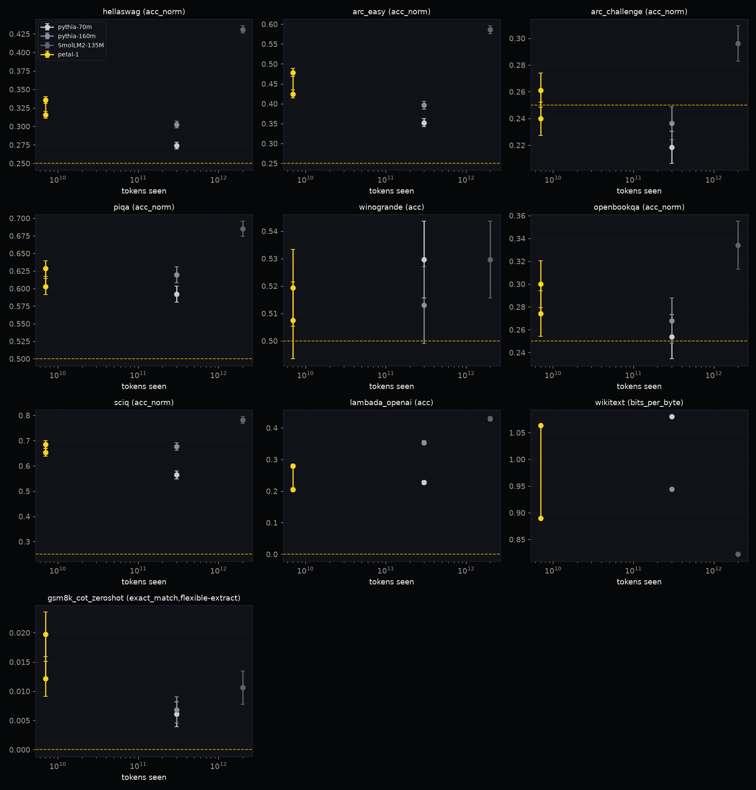
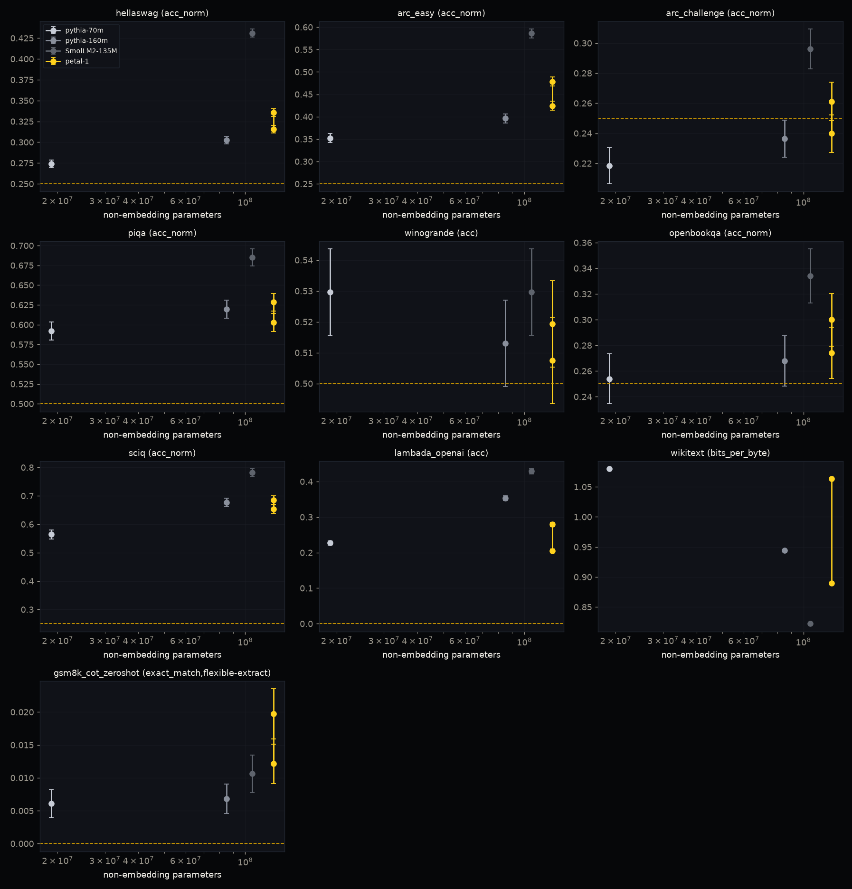

# Results: small_lm

Zero-shot suite chosen to give signal on models under 1B parameters.

Protocol v3, lm-eval 0.4.13, 0-shot. Values are the primary metric of each task with their standard error, from the latest run of each model.

| Model | Run date | Non-embedding params | Tokens seen | hellaswag (acc_norm) | arc_easy (acc_norm) | arc_challenge (acc_norm) | piqa (acc_norm) | winogrande (acc) | openbookqa (acc_norm) | sciq (acc_norm) | lambada_openai (acc) | wikitext (bits_per_byte) | gsm8k_cot_zeroshot (exact_match,flexible-extract) |
|---|---|---|---|---|---|---|---|---|---|---|---|---|---|
| pythia-70m-step143000 | 2026-11-16 16:29:12 | 18.9M | 299.89B | 0.274 ± 0.004 | 0.352 ± 0.010 | 0.218 ± 0.012 | 0.592 ± 0.011 | 0.530 ± 0.014 | 0.254 ± 0.019 | 0.564 ± 0.016 | 0.227 ± 0.006 | 1.080 | 0.006 ± 0.002 |
| pythia-160m-step143000 | 2026-11-16 16:15:27 | 85.1M | 299.89B | 0.303 ± 0.005 | 0.396 ± 0.010 | 0.236 ± 0.012 | 0.620 ± 0.011 | 0.513 ± 0.014 | 0.268 ± 0.020 | 0.677 ± 0.015 | 0.354 ± 0.007 | 0.944 | 0.007 ± 0.002 |
| SmolLM2-135M | 2026-11-16 17:16:27 | 106.2M | 2000.00B | 0.431 ± 0.005 | 0.586 ± 0.010 | 0.296 ± 0.013 | 0.685 ± 0.011 | 0.530 ± 0.014 | 0.334 ± 0.021 | 0.782 ± 0.013 | 0.429 ± 0.007 | 0.822 | 0.011 ± 0.003 |
| petal-1-150M-base | 2026-11-17 19:57:10 | 127.4M | 7.00B | 0.336 ± 0.005 | 0.479 ± 0.010 | 0.261 ± 0.013 | 0.628 ± 0.011 | 0.519 ± 0.014 | 0.300 ± 0.021 | 0.685 ± 0.015 | 0.279 ± 0.006 | 0.890 | 0.012 ± 0.003 |
| petal-1-150M | 2026-11-17 16:31:49 | 127.4M | 7.00B | 0.315 ± 0.005 | 0.424 ± 0.010 | 0.240 ± 0.012 | 0.603 ± 0.011 | 0.507 ± 0.014 | 0.274 ± 0.020 | 0.654 ± 0.015 | 0.205 ± 0.006 | 1.064 | 0.020 ± 0.004 |
| Random guessing |  |  |  | 0.250 | 0.250 | 0.250 | 0.500 | 0.500 | 0.250 | 0.250 | 0.000 |  | 0.000 |

## Score against tokens seen

## Score against non-embedding parameters

Previous versions of this report (with their plots) are archived under `history/small_lm/`, sorted by generation date. An interactive version with tooltips lives in [small_lm_public.html](small_lm_public.html).
